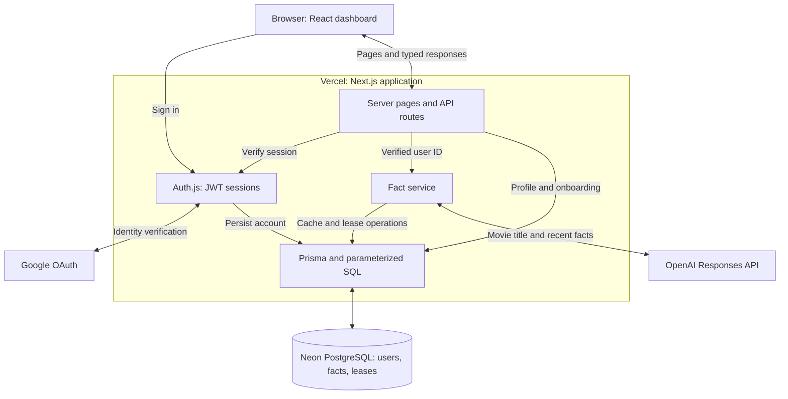
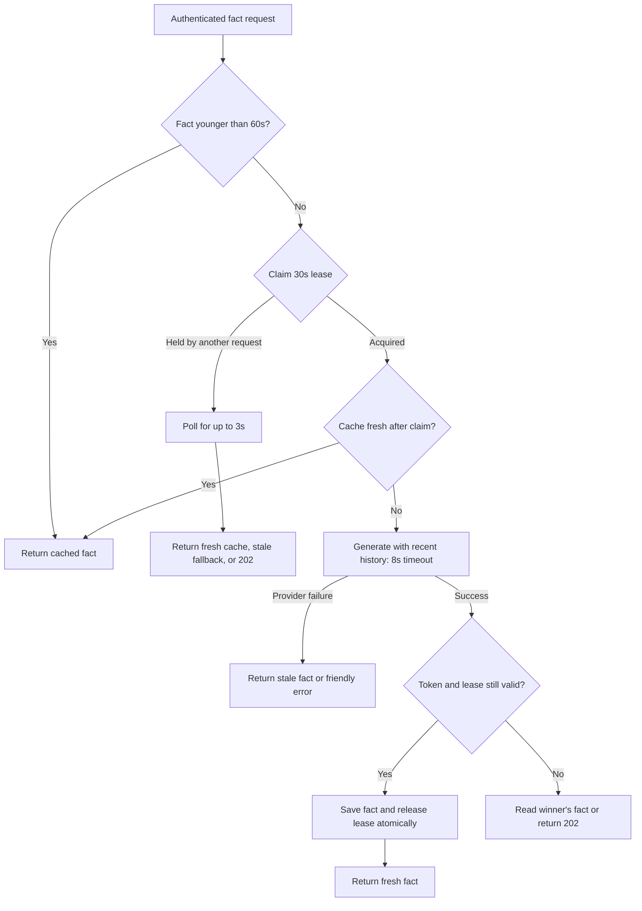

# Movie Memory

- **Product:** Google sign-in → one-time movie onboarding → a personal fact dashboard.
- **Stack:** Next.js, TypeScript, React/Tailwind, Prisma, and PostgreSQL.
- **Variant A:** A 60-second user/movie cache and a database lease coordinate generation.
- **Recovery:** Provider failures return a saved fact when available, otherwise a retryable error.
- **Delivery:** Vercel + Neon, with unit/API, real-Postgres integration, and browser checks.

A small movie companion: sign in with Google, save your favorite film, and discover a fact about it. Built with TypeScript, Next.js App Router, React, Tailwind CSS, PostgreSQL, Prisma, Auth.js, and OpenAI.

**Variant A — backend caching and correctness.** The implementation emphasizes user isolation, a precise 60-second cache, coordinated generation, and useful recovery when the provider fails. The full frontend includes onboarding, a responsive dashboard, independent fact loading, and clear recovery states.

I chose Variant A to demonstrate concurrency control, user isolation, and failure recovery in depth. A focused backend extension fits the exercise’s roughly three-hour budget better than expanding the feature set.

## Live app

Production: [movie-memory-gilt.vercel.app](https://movie-memory-gilt.vercel.app/). The deployed app uses Vercel, Neon, and the production Google OAuth callback. The instructions below are for running a separate copy on your own computer.

## Run locally (optional)

Requirements: Node.js 22.12+ and PostgreSQL (Docker Compose is provided).

```sh
npm ci
cp .env.example .env
# Fill in Google OAuth credentials, AUTH_SECRET, and OPENAI_API_KEY.
docker compose up -d
npm run db:migrate
npm run dev
```

Open http://localhost:3000 only when running the app locally with `npm run dev`. For the deployed app, use the production link above. Generate your own session secret with `openssl rand -base64 32`. Never commit `.env` or put secrets in `NEXT_PUBLIC_` variables. Prisma CLI loads `.env`; Next.js also supports `.env.local`, but its values are not automatically available to Prisma CLI.

### Google OAuth setup

Create a Google OAuth **Web application** client with `http://localhost:3000/api/auth/callback/google` as an authorized redirect URI. Configure the Google Auth Platform consent screen. This app requests only basic identity scopes (openid, email, and profile), for which Google's Testing mode permits sign-in without a test-user allowlist. Google documents this basic-identity exception in [Manage App Audience](https://support.google.com/cloud/answer/15549945). It does not override Workspace administrator restrictions or account-level policies. Test with a separate, non-allowlisted account before submission; that live reviewer-account check has not yet been recorded. Add test users if additional scopes later require them. The production OAuth callback is `https://movie-memory-gilt.vercel.app/api/auth/callback/google`. Google login needs real credentials; there is no production authentication bypass.

### Environment variables

| Variable             | Purpose                                                                          |
| -------------------- | -------------------------------------------------------------------------------- |
| `DATABASE_URL`       | Application Postgres connection; use a pooled Neon URL in deployment             |
| `DIRECT_URL`         | Direct Postgres connection for Prisma migrations                                 |
| `AUTH_SECRET`        | Random secret for signing/encrypting sessions                                    |
| `AUTH_URL`           | Canonical application origin; localhost for development, HTTPS URL in deployment |
| `AUTH_GOOGLE_ID`     | Google OAuth client ID                                                           |
| `AUTH_GOOGLE_SECRET` | Google OAuth client secret                                                       |
| `OPENAI_API_KEY`     | Server-only key for fact generation                                              |
| `OPENAI_MODEL`       | Defaults to `gpt-4.1-mini`; can be configured for the account                    |
| `TEST_DATABASE_URL`  | Disposable database for integration/browser tests; never production              |

For Prisma 6, use bounded connection settings on the application URL, e.g. `connection_limit=5&pool_timeout=3&connect_timeout=3&socket_timeout=5`, preserving Neon's TLS parameters. CLI and client versions are pinned together by the lockfile. We use Prisma 6 deliberately to keep this exercise's direct/pooled setup straightforward, rather than introduce a major-version migration during the take-home.

## Architecture



The browser never receives provider or database credentials. PostgreSQL coordinates requests across application instances; the OpenAI call runs outside a database transaction.

The application is a modular monolith. Pages and API handlers run in Next.js; external services are Google identity, OpenAI, and Postgres. There is no separate API deployment, queue, or in-memory correctness dependency.

- **Presentation:** server-rendered profile and movie information, with a client fact card that loads independently. No OpenAI call blocks the initial dashboard render. Forms and fact requests expose loading, retry, and error states; screen readers receive meaningful status updates.
- **Authentication:** Auth.js Google OAuth with JWT sessions, seven-day maximum age, and Prisma account persistence. The token carries the internal user ID. Server pages and every API handler verify the session; current movie data comes from the database. Middleware is not an authorization boundary. Logout clears the browser session; global token revocation is not implemented.
- **Movie service:** trims and validates 1–200 characters on the server. Rejects control characters and unexpected JSON properties. Onboarding atomically writes only when the user's favorite movie is null. Multiple onboarding tabs cannot overwrite each other. Changing movies after onboarding is outside Variant A's scope.
- **Fact service:** receives only the verified user ID, loads their saved movie, checks the database cache, coordinates generation, and persists results. The browser cannot select an owner or override the movie through a request body.
- **Provider boundary:** sends a JSON-encoded movie title and up to five recent facts for the same user/movie, treating both as untrusted data. It requests a different fact and typographic quotation marks. Recent context reduces repetition but cannot guarantee semantic uniqueness or correct typography; we do not rewrite generated text or retry duplicates automatically. Uses an eight-second timeout, no SDK retries, a 200-token output limit, and `store: false`. Incomplete/empty provider output is rejected. Results render as plain text. Delimiting input reduces instruction confusion but is not a guarantee of factual accuracy; trivia is explicitly labeled AI-generated.

### Data model

`User` stores optional Google name/photo, email, and nullable `favoriteMovie`. Null means onboarding is incomplete. `Account` stores the provider identity through the standard Prisma adapter. JWT sessions do not require a session table.

`MovieFact` stores owner ID, normalized movie key, display title, text, and a database timestamp. The `(userId, movieKey, createdAt DESC)` index supports the latest-fact query. Facts are user-specific even when two users choose the same movie. We retain history; retention limits would be a follow-up.

`FactGeneration` has a composite primary key on `(userId, movieKey)`, a random ownership token, and a lease expiry. Its row is temporary coordination state. All records reference their owner with cascading deletion.

Movie keys trim leading/trailing whitespace, collapse internal whitespace, and lowercase. This equates `Interstellar ` and `interstellar`. It does not identify remakes, correct spelling, or provide canonical movie IDs. Users can include a year.

### Cache and concurrency



Every lease-owner exit attempts token-qualified cleanup in `finally`. Followers never start generation without a lease; an expired owner cannot save over a replacement. The steps below define the exact timing and transaction boundaries.

1. Read the latest fact for this user/movie. It is fresh only when its timestamp is strictly greater than database `now() - interval '60 seconds'`. At 60 seconds it is expired. No timer or background job regenerates it automatically.
2. On a miss, claim a 30-second lease using one parameterized `INSERT ... ON CONFLICT ... DO UPDATE ... WHERE leaseExpiresAt <= now() RETURNING` statement. Zero returned rows means another request owns generation. Prisma's native upsert cannot express that conditional takeover; `$queryRaw` is intentional and all user values are bound parameters.
3. The winner rechecks the cache after claiming, reads up to five recent same-owner/same-movie facts, then calls OpenAI without an open database transaction.
4. Saving uses a short transaction: lock the guard row, verify its token and unexpired lease, insert the fact, and remove the guard. A stale owner cannot persist a late result or delete a replacement owner's guard. We use `clock_timestamp()` after acquiring the lock because Postgres `now()` is frozen at transaction start; both are database clocks, not app-server clocks. Fact insertion also uses database wall time.
5. Token-qualified cleanup runs in `finally`, including failures. If cleanup fails or the process dies, expiry permits recovery.
6. Followers poll every 250 ms for at most approximately three seconds, subject to bounded DB query latency. They return a fresh result when available, otherwise an old fact or `202 generating`. The browser retries `202` after one second, with a 15-second overall request deadline. It then offers manual retry. A `202` does not create a background job; it refers to another active request. A crashed lease owner may require retry after 30 seconds.

The fact route has a 20-second Vercel maximum duration. The eight-second provider timeout is comfortably below the 30-second lease. These bounds limit waiting, but provider cancellation cannot guarantee cancellation of work already accepted remotely. This is at-most-one normal burst generation, **not exactly-once external execution**. An owner that outlives its lease can overlap with a replacement; token/expiry checks prevent its late database write.

We rejected `pg_advisory_xact_lock` around the OpenAI call because it would hold a transaction and pooled connection throughout external network latency. An in-memory lock would not coordinate separate instances. Fixed 60-second timestamp buckets would permit two generations only seconds apart across a bucket boundary.

### API contract

All responses are `Cache-Control: private, no-store`. Postgres implements the intentional cache; personalized responses are not CDN-cached.

| Endpoint            | Behavior                                                                            |
| ------------------- | ----------------------------------------------------------------------------------- |
| `/api/auth/*`       | Auth.js sign-in, callback, session, logout                                          |
| `PUT /api/me/movie` | Save onboarding input `{ "movie": "Interstellar" }`; subsequent attempts return 409 |
| `POST /api/fact`    | Fetch or generate a fact for the session's user and saved movie; no owner input     |

Successful fact response:

```json
{ "status": "cached", "fact": "...", "createdAt": "2026-11-12T12:00:00.000Z" }
```

`status` is `fresh`, `cached`, or `stale-fallback`. The client validates the response schema. Active generation returns HTTP 202, `Retry-After: 1`, and `{ "status": "generating", "retryAfterMs": 1000 }`. Errors use `{ "error": { "code": "...", "message": "..." } }`. Unauthenticated calls return 401; cross-origin mutations return 403; invalid movie input returns 400; missing onboarding returns 409; unavailable services return 503.

The UI's seconds-since-generated display uses the browser clock for presentation only. Refresh is disabled with a countdown while the displayed successful fact is under 60 seconds old; errors and stale fallbacks keep retry available. The countdown does not automatically generate a fact. Server cache correctness always uses database time.

There is no root loading boundary: authentication redirects complete before a response streams, so an unauthenticated `/dashboard` request returns HTTP 307. The fact card still loads independently after the dashboard renders.

### Failures and security

OpenAI failure returns the most recent same-owner/same-movie fact when available. Without one, the user gets a friendly error. Database failures are not silently converted into success. Logging records request IDs, duration, cache outcome, and coarse failure categories without keys, provider responses, or profile data. Secrets never enter client props. Mutation origins must match `AUTH_URL`; use the documented production URL. Alternate Vercel aliases are intentionally rejected with 403, rather than trusting arbitrary forwarded hosts. Same-origin checks protect our cookie-authenticated mutations; Auth.js handles its own OAuth protections. Google name/photo fields are optional.

## Verification

```sh
npm run typecheck
npm run lint
npm test
# Set TEST_DATABASE_URL to a disposable Postgres database with migrations applied.
npm run test:integration
npm run build
npx playwright install chromium
npm run test:e2e
```

`TEST_DATABASE_URL` must refer to the same disposable database as `DATABASE_URL` for browser tests. Integration tests create unique test users and delete only their own records. CI supplies a Postgres 17 service. Never run tests against production.

Coverage includes freshness and expiration, owner/movie isolation, a 12-request concurrent burst, provider failure with/without a cached fact, expired-owner fencing, guarded cleanup, and bounded follower waiting. API tests explicitly verify unauthenticated 401 and that user A's session cannot select user B through request input. Browser tests cover onboarding, protected routes, independent fact loading, errors, stale fallback, responsive layouts, and logout.

Browser tests create signed test sessions using the test secret and intercept fact responses. This verifies the app journey, **not live Google consent or OpenAI correctness**. Real OAuth and a real provider request must be verified separately after credentials are configured.

## Deployment: Vercel + Neon

1. Create a Neon Postgres project and choose a region near the Vercel functions.
2. Import this GitHub repository into Vercel using the Next.js preset and Node.js 22. Use `npm ci` and `npm run build`.
3. Configure the environment variables above in Vercel. Mark secrets sensitive. Set `AUTH_URL` to the stable application HTTPS URL. Never use `NEXT_PUBLIC_` for secrets.
4. Configure the production callback and reviewer access as described in [Google OAuth setup](#google-oauth-setup).
5. Run `npm run db:migrate` against the deployment's direct database URL in a controlled release step before deploying. Migrations are not silently run on every preview build.
6. Deploy and verify sign-in, onboarding, cached and fresh facts, logout, and API isolation. Redeploy after changing Vercel environment variables.

Preview deployments require their own database and matching OAuth origin/callback settings. Do not point unreviewed preview code at production secrets or data. A stable staging URL is simpler than registering every ephemeral preview hostname. This repository does not provision paid infrastructure automatically.

## Tradeoffs and two more hours

The modular monolith keeps the exercise reviewable. Database caching adds a read on every request but works across restarts and instances. Polling adds short-lived database traffic; it is acceptable at this scope but should not become high-volume background orchestration. JWT sessions simplify setup but do not provide immediate global revocation. User/movie cache isolation favors simple ownership reasoning over cross-user token savings.

With two more hours, I would prioritize per-user rate limits and cost budgets, then prototype an SQS-backed generation worker on Lambda with idempotent job handling and result polling, aligned with Scowtt's stack. A reliable queue migration needs more validation than a two-hour prototype. Multi-movie support comes afterward, with per-user/per-movie cache and history isolation. Longer-term improvements include bounded fact retention, canonical movie identification, source-backed trivia, and stronger observability. Redis is only worth adding if measured database/cache load justifies another service.

Under healthy operation, the fixed movie plus 60-second successful-fact cache limits normal generation to roughly one call per user per minute. This is not a hard spend cap or a rate limiter: failed generations, persistence failures, and expired leases can cause additional calls, and multiple accounts multiply usage.

## AI usage

- I planned the architecture and deployment approach, chose Variant A, and decided the scope and tradeoffs for this take-home.
- I used an AI coding assistant during implementation to help draft code, propose test cases, and troubleshoot build and deployment issues.
- I reviewed the design decisions and pull requests myself, checked the proposed behavior against the assessment, and verified changes with automated checks and the deployed app. The tests use mocked Google/OpenAI responses where noted; they do not prove every live external-service behavior.

